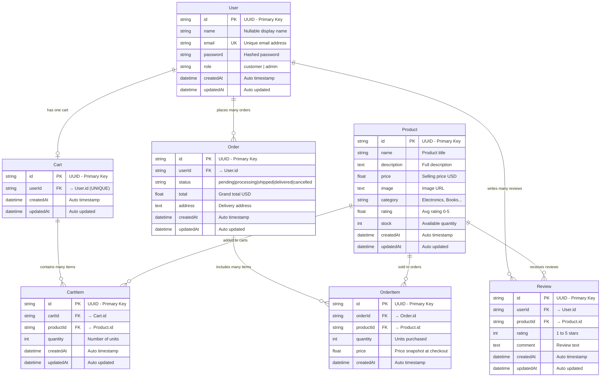

# Database Relationships — E-Commerce App

**Database:** MySQL · **ORM:** Prisma · **ID type:** UUID on all models

## ER Diagram — All Tables

---

## Table Details

### `User`
| Column | Type | Constraint | Description |
|---|---|---|---|
| `id` | String | **PK** | UUID auto-generated |
| `name` | String? | — | Optional display name |
| `email` | String | **UNIQUE** | Login identifier |
| `password` | String | — | Bcrypt hashed |
| `role` | String | default `"customer"` | `customer` or `admin` |
| `createdAt` | DateTime | auto | Account created time |
| `updatedAt` | DateTime | auto | Last modified time |

---

### `Product`
| Column | Type | Constraint | Description |
|---|---|---|---|
| `id` | String | **PK** | UUID auto-generated |
| `name` | String | — | Product title |
| `description` | String | TEXT | Full description |
| `price` | Float | — | Selling price in USD |
| `image` | String | TEXT | Image URL |
| `category` | String | — | e.g. Electronics, Books |
| `rating` | Float | default `0.0` | Average star rating |
| `stock` | Int | default `100` | Available inventory |
| `createdAt` | DateTime | auto | Listing created time |
| `updatedAt` | DateTime | auto | Last modified time |

---

### `Cart`
| Column | Type | Constraint | Description |
|---|---|---|---|
| `id` | String | **PK** | UUID auto-generated |
| `userId` | String | **FK → User**, **UNIQUE** | One cart per user |
| `createdAt` | DateTime | auto | Cart created time |
| `updatedAt` | DateTime | auto | Last modified time |

---

### `CartItem`
| Column | Type | Constraint | Description |
|---|---|---|---|
| `id` | String | **PK** | UUID auto-generated |
| `cartId` | String | **FK → Cart** | Parent cart |
| `productId` | String | **FK → Product** | Product in cart |
| `quantity` | Int | default `1` | Units in cart |
| `createdAt` | DateTime | auto | Added time |
| `updatedAt` | DateTime | auto | Last modified time |
| _(composite)_ | — | **UNIQUE(cartId, productId)** | No duplicate products per cart |

---

### `Order`
| Column | Type | Constraint | Description |
|---|---|---|---|
| `id` | String | **PK** | UUID auto-generated |
| `userId` | String | **FK → User** | Order owner |
| `status` | String | default `"pending"` | `pending` · `processing` · `shipped` · `delivered` · `cancelled` |
| `total` | Float | — | Grand total in USD |
| `address` | String | TEXT | Delivery address |
| `createdAt` | DateTime | auto | Order placed time |
| `updatedAt` | DateTime | auto | Last modified time |

---

### `OrderItem`
| Column | Type | Constraint | Description |
|---|---|---|---|
| `id` | String | **PK** | UUID auto-generated |
| `orderId` | String | **FK → Order** | Parent order |
| `productId` | String | **FK → Product** | Purchased product |
| `quantity` | Int | — | Units purchased |
| `price` | Float | — | **Price snapshot** at checkout |
| `createdAt` | DateTime | auto | Created time |

> ⚠️ `price` is stored here — not read from `Product.price` — so historical order totals remain accurate even if the product price changes later.

---

### `Review`
| Column | Type | Constraint | Description |
|---|---|---|---|
| `id` | String | **PK** | UUID auto-generated |
| `userId` | String | **FK → User** | Review author |
| `productId` | String | **FK → Product** | Reviewed product |
| `rating` | Int | — | 1 – 5 stars |
| `comment` | String | TEXT | Review body |
| `createdAt` | DateTime | auto | Submitted time |
| `updatedAt` | DateTime | auto | Last modified time |
| _(composite)_ | — | **UNIQUE(userId, productId)** | One review per user per product |

---

## Relationships Summary

| From | To | Type | FK Column | On Delete |
|---|---|---|---|---|
| `User` | `Cart` | 1-to-1 | `Cart.userId` | Cascade |
| `User` | `Order` | 1-to-many | `Order.userId` | Cascade |
| `User` | `Review` | 1-to-many | `Review.userId` | Cascade |
| `Cart` | `CartItem` | 1-to-many | `CartItem.cartId` | Cascade |
| `Product` | `CartItem` | 1-to-many | `CartItem.productId` | Cascade |
| `Order` | `OrderItem` | 1-to-many | `OrderItem.orderId` | Cascade |
| `Product` | `OrderItem` | 1-to-many | `OrderItem.productId` | Cascade |
| `Product` | `Review` | 1-to-many | `Review.productId` | Cascade |

---

## Cascade Delete Summary

| Delete this | Also removes |
|---|---|
| `User` | Cart → CartItems, Orders → OrderItems, Reviews |
| `Product` | CartItems, OrderItems, Reviews |
| `Cart` | CartItems |
| `Order` | OrderItems |
