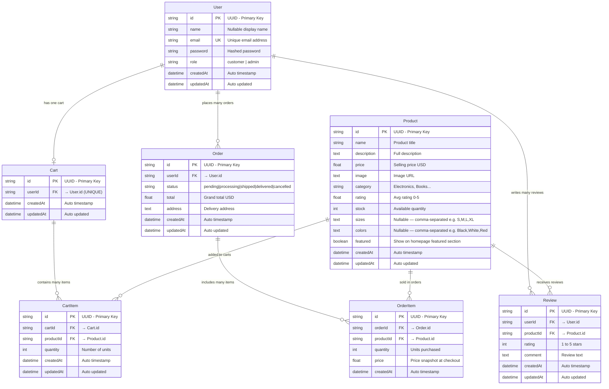

# Database Relationships — E-Commerce App

**Database:** MySQL · **ORM:** Prisma · **ID type:** UUID on all models

> Last updated: Added `sizes`, `colors`, `featured` columns to `Product` — migration `20261031044534_add_sizes_colors_featured`

---

## Graph Overview

<!-- SVG graph — renders in VS Code Preview, GitHub, and any browser -->
<svg xmlns="http://www.w3.org/2000/svg" viewBox="0 0 900 580" width="900" height="580" font-family="ui-monospace,monospace" font-size="12">

  <!-- ── Background ── -->
  <rect width="900" height="580" fill="#0f172a" rx="16"/>
  <pattern id="dots" x="0" y="0" width="28" height="28" patternUnits="userSpaceOnUse">
    <circle cx="1" cy="1" r="1" fill="#334155" opacity="0.5"/>
  </pattern>
  <rect width="900" height="580" fill="url(#dots)"/>

  <!-- ══ LINES ══ -->
  <!-- User → Cart -->
  <line x1="160" y1="120" x2="310" y2="120" stroke="#38bdf8" stroke-width="1.5" stroke-dasharray="5,3" opacity="0.7"/>
  <circle cx="310" cy="120" r="3" fill="#38bdf8"/>
  <!-- User → Order -->
  <line x1="160" y1="140" x2="310" y2="300" stroke="#38bdf8" stroke-width="1.5" stroke-dasharray="5,3" opacity="0.7"/>
  <circle cx="310" cy="300" r="3" fill="#38bdf8"/>
  <!-- User → Review -->
  <line x1="160" y1="150" x2="310" y2="460" stroke="#38bdf8" stroke-width="1.5" stroke-dasharray="5,3" opacity="0.7"/>
  <circle cx="310" cy="460" r="3" fill="#38bdf8"/>
  <!-- Cart → CartItem -->
  <line x1="440" y1="120" x2="570" y2="210" stroke="#a78bfa" stroke-width="1.5" stroke-dasharray="5,3" opacity="0.7"/>
  <circle cx="570" cy="210" r="3" fill="#a78bfa"/>
  <!-- Product → CartItem -->
  <line x1="730" y1="130" x2="710" y2="210" stroke="#a78bfa" stroke-width="1.5" stroke-dasharray="5,3" opacity="0.7"/>
  <circle cx="710" cy="210" r="3" fill="#a78bfa"/>
  <!-- Order → OrderItem -->
  <line x1="440" y1="310" x2="570" y2="355" stroke="#34d399" stroke-width="1.5" stroke-dasharray="5,3" opacity="0.7"/>
  <circle cx="570" cy="355" r="3" fill="#34d399"/>
  <!-- Product → OrderItem -->
  <line x1="730" y1="150" x2="730" y2="355" stroke="#34d399" stroke-width="1.5" stroke-dasharray="5,3" opacity="0.7"/>
  <circle cx="730" cy="355" r="3" fill="#34d399"/>
  <!-- Product → Review -->
  <line x1="730" y1="170" x2="460" y2="460" stroke="#fb923c" stroke-width="1.5" stroke-dasharray="5,3" opacity="0.7"/>
  <circle cx="460" cy="460" r="3" fill="#fb923c"/>

  <!-- ══ TABLE BOXES ══ -->

  <!-- User -->
  <g>
    <rect x="20" y="60" width="140" height="160" rx="10" fill="#1e293b" stroke="#38bdf8" stroke-width="1.5"/>
    <rect x="20" y="60" width="140" height="30" rx="10" fill="#38bdf8" opacity="0.15"/>
    <rect x="20" y="76" width="140" height="14" fill="#38bdf8" opacity="0.15"/>
    <text x="90" y="80" text-anchor="middle" fill="#38bdf8" font-weight="bold" font-size="13">User</text>
    <line x1="20" y1="90" x2="160" y2="90" stroke="#334155" stroke-width="1"/>
    <text x="30" y="106" fill="#94a3b8" font-size="10">PK</text><text x="55" y="106" fill="#e2e8f0">id</text>
    <text x="55" y="122" fill="#e2e8f0">name</text>
    <text x="30" y="138" fill="#fbbf24" font-size="10">UK</text><text x="55" y="138" fill="#e2e8f0">email</text>
    <text x="55" y="154" fill="#e2e8f0">password</text>
    <text x="55" y="170" fill="#e2e8f0">role</text>
    <text x="55" y="186" fill="#e2e8f0">createdAt</text>
    <text x="55" y="202" fill="#e2e8f0">updatedAt</text>
  </g>

  <!-- Product (updated: sizes, colors, featured) -->
  <g>
    <rect x="610" y="50" width="170" height="230" rx="10" fill="#1e293b" stroke="#f472b6" stroke-width="1.5"/>
    <rect x="610" y="50" width="170" height="30" rx="10" fill="#f472b6" opacity="0.15"/>
    <rect x="610" y="66" width="170" height="14" fill="#f472b6" opacity="0.15"/>
    <text x="695" y="70" text-anchor="middle" fill="#f472b6" font-weight="bold" font-size="13">Product</text>
    <line x1="610" y1="80" x2="780" y2="80" stroke="#334155" stroke-width="1"/>
    <text x="620" y="96"  fill="#94a3b8" font-size="10">PK</text><text x="645" y="96"  fill="#e2e8f0">id</text>
    <text x="645" y="112" fill="#e2e8f0">name</text>
    <text x="645" y="128" fill="#e2e8f0">description</text>
    <text x="645" y="144" fill="#e2e8f0">price</text>
    <text x="645" y="160" fill="#e2e8f0">category</text>
    <text x="645" y="176" fill="#e2e8f0">rating · stock</text>
    <text x="620" y="192" fill="#4ade80" font-size="10">NEW</text><text x="648" y="192" fill="#86efac">sizes</text>
    <text x="620" y="208" fill="#4ade80" font-size="10">NEW</text><text x="648" y="208" fill="#86efac">colors</text>
    <text x="620" y="224" fill="#4ade80" font-size="10">NEW</text><text x="648" y="224" fill="#86efac">featured</text>
    <text x="645" y="240" fill="#e2e8f0">createdAt</text>
    <text x="645" y="256" fill="#e2e8f0">updatedAt</text>
  </g>

  <!-- Cart -->
  <g>
    <rect x="310" y="80" width="130" height="110" rx="10" fill="#1e293b" stroke="#a78bfa" stroke-width="1.5"/>
    <rect x="310" y="80" width="130" height="30" rx="10" fill="#a78bfa" opacity="0.15"/>
    <rect x="310" y="96" width="130" height="14" fill="#a78bfa" opacity="0.15"/>
    <text x="375" y="100" text-anchor="middle" fill="#a78bfa" font-weight="bold" font-size="13">Cart</text>
    <line x1="310" y1="110" x2="440" y2="110" stroke="#334155" stroke-width="1"/>
    <text x="320" y="126" fill="#94a3b8" font-size="10">PK</text><text x="345" y="126" fill="#e2e8f0">id</text>
    <text x="320" y="142" fill="#fb7185" font-size="10">FK</text><text x="345" y="142" fill="#e2e8f0">userId</text>
    <text x="320" y="158" fill="#fbbf24" font-size="10">UK</text><text x="345" y="158" fill="#94a3b8" font-size="10">(unique)</text>
    <text x="345" y="174" fill="#e2e8f0">createdAt</text>
  </g>

  <!-- CartItem -->
  <g>
    <rect x="545" y="200" width="155" height="140" rx="10" fill="#1e293b" stroke="#a78bfa" stroke-width="1.5"/>
    <rect x="545" y="200" width="155" height="30" rx="10" fill="#a78bfa" opacity="0.15"/>
    <rect x="545" y="216" width="155" height="14" fill="#a78bfa" opacity="0.15"/>
    <text x="622" y="220" text-anchor="middle" fill="#a78bfa" font-weight="bold" font-size="13">CartItem</text>
    <line x1="545" y1="230" x2="700" y2="230" stroke="#334155" stroke-width="1"/>
    <text x="555" y="246" fill="#94a3b8" font-size="10">PK</text><text x="580" y="246" fill="#e2e8f0">id</text>
    <text x="555" y="262" fill="#fb7185" font-size="10">FK</text><text x="580" y="262" fill="#e2e8f0">cartId</text>
    <text x="555" y="278" fill="#fb7185" font-size="10">FK</text><text x="580" y="278" fill="#e2e8f0">productId</text>
    <text x="580" y="294" fill="#e2e8f0">quantity</text>
    <text x="580" y="310" fill="#e2e8f0">createdAt</text>
    <text x="555" y="326" fill="#fbbf24" font-size="9">UNIQUE(cartId, productId)</text>
  </g>

  <!-- Order -->
  <g>
    <rect x="310" y="260" width="130" height="130" rx="10" fill="#1e293b" stroke="#34d399" stroke-width="1.5"/>
    <rect x="310" y="260" width="130" height="30" rx="10" fill="#34d399" opacity="0.15"/>
    <rect x="310" y="276" width="130" height="14" fill="#34d399" opacity="0.15"/>
    <text x="375" y="280" text-anchor="middle" fill="#34d399" font-weight="bold" font-size="13">Order</text>
    <line x1="310" y1="290" x2="440" y2="290" stroke="#334155" stroke-width="1"/>
    <text x="320" y="306" fill="#94a3b8" font-size="10">PK</text><text x="345" y="306" fill="#e2e8f0">id</text>
    <text x="320" y="322" fill="#fb7185" font-size="10">FK</text><text x="345" y="322" fill="#e2e8f0">userId</text>
    <text x="345" y="338" fill="#e2e8f0">status</text>
    <text x="345" y="354" fill="#e2e8f0">total</text>
    <text x="345" y="370" fill="#e2e8f0">address</text>
  </g>

  <!-- OrderItem -->
  <g>
    <rect x="545" y="345" width="155" height="140" rx="10" fill="#1e293b" stroke="#34d399" stroke-width="1.5"/>
    <rect x="545" y="345" width="155" height="30" rx="10" fill="#34d399" opacity="0.15"/>
    <rect x="545" y="361" width="155" height="14" fill="#34d399" opacity="0.15"/>
    <text x="622" y="365" text-anchor="middle" fill="#34d399" font-weight="bold" font-size="13">OrderItem</text>
    <line x1="545" y1="375" x2="700" y2="375" stroke="#334155" stroke-width="1"/>
    <text x="555" y="391" fill="#94a3b8" font-size="10">PK</text><text x="580" y="391" fill="#e2e8f0">id</text>
    <text x="555" y="407" fill="#fb7185" font-size="10">FK</text><text x="580" y="407" fill="#e2e8f0">orderId</text>
    <text x="555" y="423" fill="#fb7185" font-size="10">FK</text><text x="580" y="423" fill="#e2e8f0">productId</text>
    <text x="580" y="439" fill="#e2e8f0">quantity</text>
    <text x="580" y="455" fill="#e2e8f0">price ⚡snapshot</text>
    <text x="580" y="471" fill="#e2e8f0">createdAt</text>
  </g>

  <!-- Review -->
  <g>
    <rect x="310" y="430" width="140" height="110" rx="10" fill="#1e293b" stroke="#fb923c" stroke-width="1.5"/>
    <rect x="310" y="430" width="140" height="30" rx="10" fill="#fb923c" opacity="0.15"/>
    <rect x="310" y="446" width="140" height="14" fill="#fb923c" opacity="0.15"/>
    <text x="380" y="450" text-anchor="middle" fill="#fb923c" font-weight="bold" font-size="13">Review</text>
    <line x1="310" y1="460" x2="450" y2="460" stroke="#334155" stroke-width="1"/>
    <text x="320" y="476" fill="#94a3b8" font-size="10">PK</text><text x="345" y="476" fill="#e2e8f0">id</text>
    <text x="320" y="492" fill="#fb7185" font-size="10">FK</text><text x="345" y="492" fill="#e2e8f0">userId</text>
    <text x="320" y="508" fill="#fb7185" font-size="10">FK</text><text x="345" y="508" fill="#e2e8f0">productId</text>
    <text x="345" y="524" fill="#e2e8f0">rating · comment</text>
    <text x="320" y="535" fill="#fbbf24" font-size="9">UNIQUE(userId, productId)</text>
  </g>

  <!-- Legend -->
  <g transform="translate(20, 490)">
    <rect width="260" height="74" rx="8" fill="#1e293b" stroke="#334155" stroke-width="1"/>
    <text x="10" y="16" fill="#94a3b8" font-size="10" font-weight="bold">LEGEND</text>
    <rect x="10" y="22" width="14" height="1.5" fill="#38bdf8"/>
    <text x="30" y="30" fill="#cbd5e1" font-size="10">User relationships</text>
    <rect x="10" y="34" width="14" height="1.5" fill="#a78bfa"/>
    <text x="30" y="42" fill="#cbd5e1" font-size="10">Cart relationships</text>
    <rect x="130" y="22" width="14" height="1.5" fill="#34d399"/>
    <text x="150" y="30" fill="#cbd5e1" font-size="10">Order relationships</text>
    <rect x="130" y="34" width="14" height="1.5" fill="#fb923c"/>
    <text x="150" y="42" fill="#cbd5e1" font-size="10">Review relationships</text>
    <text x="10" y="58" fill="#fb7185" font-size="10">FK = Foreign Key</text>
    <text x="100" y="58" fill="#fbbf24" font-size="10">UK = Unique Key</text>
    <text x="195" y="58" fill="#94a3b8" font-size="10">PK = Primary Key</text>
    <text x="10" y="70" fill="#4ade80" font-size="10">NEW = Added in migration 20261031</text>
  </g>

</svg>

---

## ER Diagram — All Tables

---

## Table Details

### `User`
| Column | Type | Constraint | Description |
|---|---|---|---|
| `id` | String | **PK** | UUID auto-generated |
| `name` | String? | — | Optional display name |
| `email` | String | **UNIQUE** | Login identifier |
| `password` | String | — | Bcrypt hashed |
| `role` | String | default `"customer"` | `customer` or `admin` |
| `createdAt` | DateTime | auto | Account created time |
| `updatedAt` | DateTime | auto | Last modified time |

---

### `Product` ⬅ updated
| Column | Type | Constraint | Description |
|---|---|---|---|
| `id` | String | **PK** | UUID auto-generated |
| `name` | String | — | Product title |
| `description` | String | TEXT | Full description |
| `price` | Float | — | Selling price in USD |
| `image` | String | TEXT | Image URL |
| `category` | String | — | e.g. Electronics, Books |
| `rating` | Float | default `0.0` | Average star rating (auto-recalculated on review) |
| `stock` | Int | default `100` | Available inventory |
| `sizes` | String? | TEXT, nullable | Comma-separated size options e.g. `"S,M,L,XL"` or `"28,30,32"` |
| `colors` | String? | TEXT, nullable | Comma-separated colour names e.g. `"Black,White,Red"` |
| `featured` | Boolean | default `false` | When `true`, shown in the homepage **Featured Products** section |
| `createdAt` | DateTime | auto | Listing created time |
| `updatedAt` | DateTime | auto | Last modified time |

> **How sizes & colors work:** stored as plain comma-separated text. The admin form provides preset buttons (XS–XXL, shoe sizes, 10 colour swatches) plus a free-text input. The product detail page parses them back into arrays and renders interactive pickers.
>
> **How featured works:** toggled via a switch in the admin create/edit form. The home page queries `WHERE featured = true ORDER BY rating DESC` to populate the Top Rated section.

---

### `Cart`
| Column | Type | Constraint | Description |
|---|---|---|---|
| `id` | String | **PK** | UUID auto-generated |
| `userId` | String | **FK → User**, **UNIQUE** | One cart per user |
| `createdAt` | DateTime | auto | Cart created time |
| `updatedAt` | DateTime | auto | Last modified time |

---

### `CartItem`
| Column | Type | Constraint | Description |
|---|---|---|---|
| `id` | String | **PK** | UUID auto-generated |
| `cartId` | String | **FK → Cart** | Parent cart |
| `productId` | String | **FK → Product** | Product in cart |
| `quantity` | Int | default `1` | Units in cart |
| `createdAt` | DateTime | auto | Added time |
| `updatedAt` | DateTime | auto | Last modified time |
| _(composite)_ | — | **UNIQUE(cartId, productId)** | No duplicate products per cart |

---

### `Order`
| Column | Type | Constraint | Description |
|---|---|---|---|
| `id` | String | **PK** | UUID auto-generated |
| `userId` | String | **FK → User** | Order owner |
| `status` | String | default `"pending"` | `pending` · `processing` · `shipped` · `delivered` · `cancelled` |
| `total` | Float | — | Grand total in USD |
| `address` | String | TEXT | Delivery address |
| `createdAt` | DateTime | auto | Order placed time |
| `updatedAt` | DateTime | auto | Last modified time |

---

### `OrderItem`
| Column | Type | Constraint | Description |
|---|---|---|---|
| `id` | String | **PK** | UUID auto-generated |
| `orderId` | String | **FK → Order** | Parent order |
| `productId` | String | **FK → Product** | Purchased product |
| `quantity` | Int | — | Units purchased |
| `price` | Float | — | **Price snapshot** at checkout |
| `createdAt` | DateTime | auto | Created time |

> ⚠️ `price` is stored on `OrderItem` — not read from `Product.price` — so historical order totals stay accurate even if the product price changes later.

---

### `Review`
| Column | Type | Constraint | Description |
|---|---|---|---|
| `id` | String | **PK** | UUID auto-generated |
| `userId` | String | **FK → User** | Review author |
| `productId` | String | **FK → Product** | Reviewed product |
| `rating` | Int | — | 1 – 5 stars |
| `comment` | String | TEXT | Review body |
| `createdAt` | DateTime | auto | Submitted time |
| `updatedAt` | DateTime | auto | Last modified time |
| _(composite)_ | — | **UNIQUE(userId, productId)** | One review per user per product |

---

## Relationships Summary

| From | To | Type | FK Column | On Delete |
|---|---|---|---|---|
| `User` | `Cart` | 1-to-1 | `Cart.userId` | Cascade |
| `User` | `Order` | 1-to-many | `Order.userId` | Cascade |
| `User` | `Review` | 1-to-many | `Review.userId` | Cascade |
| `Cart` | `CartItem` | 1-to-many | `CartItem.cartId` | Cascade |
| `Product` | `CartItem` | 1-to-many | `CartItem.productId` | Cascade |
| `Order` | `OrderItem` | 1-to-many | `OrderItem.orderId` | Cascade |
| `Product` | `OrderItem` | 1-to-many | `OrderItem.productId` | Cascade |
| `Product` | `Review` | 1-to-many | `Review.productId` | Cascade |

---

## Cascade Delete Summary

| Delete this | Also removes |
|---|---|
| `User` | Cart → CartItems, Orders → OrderItems, Reviews |
| `Product` | CartItems, OrderItems, Reviews |
| `Cart` | CartItems |
| `Order` | OrderItems |

---

## Migration History

| Migration | Date | Changes |
|---|---|---|
| `20261028064122_init` | 2026-10-28 | Initial schema — Product, Cart, CartItem |
| `20261028065848_add_user_model` | 2026-10-28 | Added User model |
| `20261028071645_add_ecommerce_models` | 2026-10-28 | Added Order, OrderItem, Review |
| `20261030042930_change_role_default_to_customer` | 2026-10-30 | Changed User.role default from `"user"` to `"customer"` |
| `20261031044534_add_sizes_colors_featured` | 2026-10-31 | Added `sizes` (TEXT?), `colors` (TEXT?), `featured` (Boolean) to Product |
